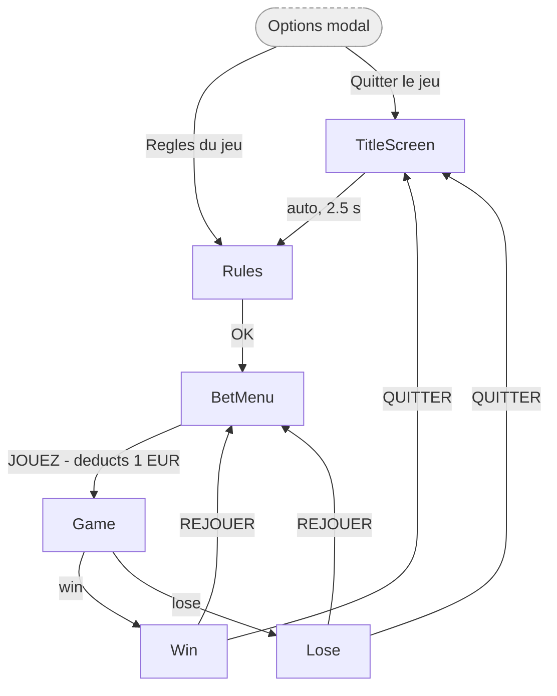

# Screens & Navigation Flow

Mise à jour : `JOUEZ` ouvre désormais un [matchmaking simulé](docs/MATCHMAKING.md) avant `Game`, avec profils aléatoires et remboursement si la recherche est annulée.

> **Purpose.** This game is a FDJ instant-win prototype (French UI, euro amounts).
> This document describes **every screen, what it contains, and how the player moves between them**,
> so the whole shell can be rebuilt outside Unity — the target stack is **Web / React**.
> It is deliberately flow-focused: the gameplay round itself is not yet specified

---

## 1. Screen model

Three independent UI layers. Reproduce all three — the flow depends on their separation.

| Layer | Rule | React equivalent |
|---|---|---|
| **Screens** | Exactly **one** visible at a time. Mounting plays an intro animation, leaving plays an outro. | A route / a `<CurrentScreen />` switch |
| **Modal** | At most **one** open, rendered above the active screen. **Auto-closes whenever the screen changes.** | A portal-rendered dialog |
| **Persistent overlay** | Always mounted, on every screen, never part of the flow. | A fixed-position bar outside the router |

Z-order: `screen` < `persistent overlay` < `modal`.

"Options → Règles du jeu" close the modal and navigate in one step, for free.

Screen ids (strings, stable): `TitleScreen`, `Rules`, `BetMenu`, `Game`, `Win`, `Lose`.
Modal id: `Options`. Initial screen: **`TitleScreen`**.

---

## 2. Screens

### 2.1 `TitleScreen` — splash / attract

Purpose: brand the game and pitch it. **Non-interactive** — it leaves on its own after **2.5 s**.

Content:
- Blurred background + logo
- Pitch: *« Creusez pour découvrir un maximum de gains »*
- Prize tag: *« GAGNEZ JUSQU'À »* / *« 10 000 € ! »*
- Ambient firefly particles

Exit: **auto-advance → `Rules` after 2.5 s.**

---

### 2.2 `Rules` — how to play

Purpose: explain the game. Reachable at any time from the Options modal.

Content:
- Title *« Règles du jeu »*
- A **scrollable body** with a vertical scrollbar
- All the game is explained in this scrollable body, with nice visuals
- Footer: *« Pour retrouver les règles pendant le jeu, cliquez sur ⚙ »*
- **`OK`** button

Exit: **`OK` → `BetMenu`**

---

### 2.3 `BetMenu` — confirm the bet and start

Purpose: the paywall. This is where money is actually deducted.

Content:
- Use the same visuals and layout as the Title Screen, but below add a "JOUEZ 1€" button

Behaviour of `JOUEZ 1€`:
1. Check the purse can afford the bet.
2. If not → refuse (show an "insufficient funds" message) and **stay on this screen**.
3. If yes → deduct the bet from the purse, then navigate to `Game`.

Exit: **`JOUEZ` → `Game`** (only when affordable)

---

### 2.4 `Game` — the round

Purpose: host the actual gameplay. **The mechanic is not specified yet.**

In the prototype this screen is a placeholder: a "GAME" label plus two debug buttons,
`WIN (debug)` and `LOSE (debug)`, that jump straight to the outcome screens.

Keep the debug win/lose buttons behind a dev flag — they make the whole flow testable before the game exists.

Exits: **win → `Win`**, **lose → `Lose`**

---

### 2.5 `Win` — victory

Content:
- Title *« Félicitations »*
- Body *« VOUS AVEZ GAGNÉ »*
- **Prize amount** (e.g. `0,00 €`) — this is the value the round produced
- Heavy celebration FX: burst, sparks, magic dust, fireflies, glow (a reveal delay before the amount appears)
- **`REJOUER`** and **`QUITTER`** buttons

Exits: **`REJOUER` → `BetMenu`** · **`QUITTER` → `TitleScreen`**

> The prize amount should also be **credited to the purse** on entering this screen. 

---

### 2.6 `Lose` — game over

Content:
- Title *« Partie Terminée »*
- Body *« Vous pouvez retenter votre chance »*
- A subdued "lose" FX (glow + circle)
- **`REJOUER`** and **`QUITTER`** buttons

Exits: **`REJOUER` → `BetMenu`** · **`QUITTER` → `TitleScreen`**

---

## 3. Modal & persistent overlay

### 3.1 `Options` modal

Opened from the settings button in the persistent overlay — **available on every screen**.
Full-screen black backdrop at ~60 % opacity, blocks input to whatever is behind it.

Content:
- **Close** button (×)
- **« Musique »** — on/off toggle (checkbox + speaker / muted-speaker icon)
- **« Sons »** — on/off toggle, same visuals
- **« Règles du jeu »** — navigates to the `Rules` screen (and the modal closes as a side effect of the screen change)
- **« Règlement de ce jeu »** — external link, opens the regulations URL in a new tab (URL is currently empty — must be provided)
- **« Quitter le jeu »** — navigates to `TitleScreen`

### 3.2 Purse overlay

Always visible, on every screen, above the screen layer and below the modal.

- The player's balance, formatted as **`13,00 €`** (French: comma decimal separator, `€` suffix)
- A **settings** button that opens the `Options` modal

It is never shown/hidden by navigation — mount it once, outside the router.

---

## 4. Navigation flow

The `Options` modal can be opened **from any screen** via the purse overlay, and closes itself
on any navigation.

### Transition table

| From | Trigger | To | Notes |
|---|---|---|---|
| `TitleScreen` | automatic after **2.5 s** | `Rules` | no user input; instant swap out |
| `Rules` | `OK` | `BetMenu` | |
| `BetMenu` | `JOUEZ` | `Game` | **deducts the bet** first; blocked if unaffordable |
| `Game` | round won | `Win` | debug button in the prototype |
| `Game` | round lost | `Lose` | debug button in the prototype |
| `Win` / `Lose` | `REJOUER` | `BetMenu` | replay loop — pays again |
| `Win` / `Lose` | `QUITTER` | `TitleScreen` | back to the start |
| *any screen* | purse settings button | opens `Options` | modal, no screen change |
| `Options` | close (×) | — | modal only |
| `Options` | `Règles du jeu` | `Rules` | modal auto-closes |
| `Options` | `Quitter le jeu` | `TitleScreen` | modal auto-closes |
| `Options` | `Règlement de ce jeu` | external URL | new tab, no navigation |

There is **no pause state and no back button.** The only way out of a round is win or lose.

---

## 5. State & data

**Purse.** Store the balance as an **integer number of cents** and format on display — never as a float.
Format: `1234` → `« 12,34 € »`.

**Economy defaults** (tunable, keep them in one config object):

| Setting | Value |
|---|---|
| Starting purse | 20 € |
| Bet per game | 1 € (fixed) |
| Advertised jackpot | 10 000 € |

**Audio.** Two independent flags, music and SFX, both on by default, toggled from the Options modal.
UI clicks have a sound;

**Persistence: none.** The purse resets to 20 € on every load and the audio flags are session-only.

---

## 6. Layout & style notes

- Design frame is **1080 × 1920**, scaled to **match width** — i.e. width is authoritative, height overflows
  or letterboxes. In CSS terms: a fixed-aspect container that scales with viewport width.
- All copy is **French**. Money uses a comma decimal separator and a trailing `€`.
- Screens transition with an intro/outro animation
